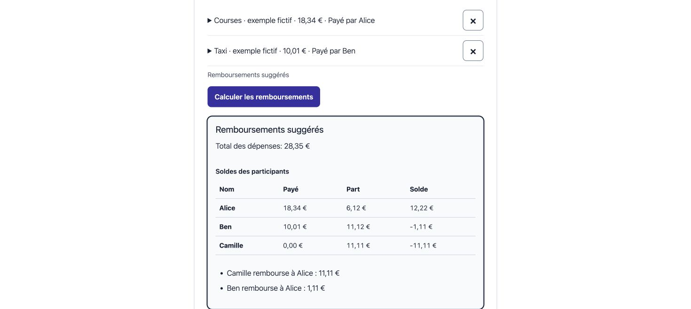

# Partly Split Expenses Block


A free, native WordPress calculator for shared expenses: multiple payers, equal or weighted shares, exact cents, and suggested repayments. English, French and Spanish. No Partly account, API key, subscription or build step.

[English](#english) · [Français](#français) · [Español](#español)

**Version 1.0.0 — original installable ZIP:** [Download from Partly](https://partly-app.com/downloads/partly-split-expenses-block-1.0.0.zip)

### Try the public form before installing

[Open the block’s public form demo — English, Français, Español](https://partly-app.com/downloads/wordpress-playground/demo.html)

This demo uses the unchanged version 1.0.0 front-end form for **2–30 participants**, with fictional examples to enter yourself. It does not run WordPress or simulate the Gutenberg editor. After installation, you configure the language, currency and optional credit inside WordPress. Reloading clears your calculator entries.

**Use online before installing:** [English](https://partly-app.com/en/tools/split-expenses-calculator/) · [Français](https://partly-app.com/fr/tools/split-expenses-calculator/) · [Español](https://partly-app.com/es/tools/split-expenses-calculator/)

These links open Partly’s separate web calculator for up to **12 people**, without a Partly account. They do not run the WordPress block, which supports **2–30 participants**, or transfer entries between the two tools.

**WordPress.org status on 29 October 2026:** submitted, automated scanning passed, manual review pending. This is an independent direct distribution; it does not claim approval or listing in the WordPress Plugin Directory.



*Real native WordPress block, fictional expenses. The screenshot shows the 28.35 EUR example described below.*

## English

### Install manually

1. Download the original ZIP linked above. Use this installable package rather than a GitHub-generated source archive.
2. In WordPress, open **Plugins → Add New Plugin → Upload Plugin**. Select the ZIP, install it and activate **Partly Split Expenses Block**. Your WordPress account needs permission to install plugins.
3. Edit a post or page in the block editor and add **Partly Split Expenses**. Choose the language and currency in the block settings. Save or publish the page normally.
4. Visitors add participants and expenses, select each payer and the participants sharing each expense, then calculate. A weight of **0 excludes** someone from that expense; positive whole-number weights allow unequal shares. These are suggestions, not payments.

For a source installation, copy this repository's plugin files to `wp-content/plugins/partly-split-expenses-block/`, with `partly-split-expenses-block.php` directly inside that folder, then activate the plugin. Do not add an extra nested plugin folder. The code is readable and needs no compilation or external package installation.

### A small example

Add Alice, Ben and Camille. Alice pays **18.34 EUR** for everyone (weights 1/1/1); Ben pays **10.01 EUR** for Ben and Camille only (weights 0/1/1). Total: **28.35 EUR**. The suggested repayments are **Camille → Alice 11.11 EUR** and **Ben → Alice 1.11 EUR**. The remaining cent is allocated deterministically; participant order breaks equal-remainder ties. Removing or changing inputs invalidates the old result, so calculate again.

### Limits and privacy

- 2–30 participants, up to 100 expenses; one currency per calculation: EUR, USD, GBP, CHF or CAD. No currency conversion.
- Positive expenses only. Each expense is at most 1,000,000.00; the combined limit is 10,000,000.00. Whole-number weights range from 0 to 10,000, with at least one included participant per expense.
- No transfer is initiated and no bank account is connected. The suggestions do not promise the globally smallest number of transfers.
- Names and amounts remain in the current calculator's browser memory. This block makes no API requests and adds no tracking, cookies or browser storage. Reloading clears the entries. WordPress saves the editor's language, currency and optional credit setting; other plugins may behave differently.
- The optional Partly credit is **off by default**. If the editor enables it, it opens a separate public Partly page without the entered names, amounts, identifiers or referrer. It is never required for calculation.
- Declared minimums: WordPress 6.5 and PHP 7.4. Tested in the owner session on WordPress 7.1.4 / PHP 8.4.4; older-version compatibility has not been exhaustively tested.

[English guide](https://partly-app.com/en/integrations/wordpress/)

### For a shared space

A flatshare kitchen, residence or guest welcome area can use the free [A4 PDF poster](https://partly-app.com/downloads/community-kit/partly-community-calculator-en-a4.pdf). Its QR opens the separate web calculator for up to 12 people; it does not install WordPress. Find the preview and printing instructions in the [community kit](https://partly-app.com/en/integrations/#community-kit).

## Français

### Installer manuellement

1. Téléchargez le ZIP original en haut de cette page. Utilisez ce paquet installable plutôt qu'une archive de sources générée par GitHub.
2. Dans WordPress, ouvrez **Extensions → Ajouter une extension → Téléverser une extension**. Sélectionnez le ZIP, installez et activez **Partly Split Expenses Block**. Votre compte WordPress doit pouvoir installer des extensions.
3. Modifiez un article ou une page dans l'éditeur de blocs, ajoutez **Partly Split Expenses**, puis choisissez la langue et la devise dans les réglages du bloc. Enregistrez ou publiez la page normalement.
4. Ajoutez les participants et les dépenses, indiquez qui avance chaque montant et qui partage chaque dépense, puis calculez. Un poids **0 exclut** une personne de la dépense ; les poids entiers positifs permettent des parts inégales. Aucun paiement n'est exécuté.

Pour une installation des sources, copiez les fichiers du plugin dans `wp-content/plugins/partly-split-expenses-block/`, avec `partly-split-expenses-block.php` directement dans ce dossier, puis activez l'extension. Évitez un dossier supplémentaire imbriqué. Aucun outil de compilation ni paquet externe n'est nécessaire.

### Exemple fictif

Alice, Ben et Camille partagent 18,34 EUR avancés par Alice (poids 1/1/1). Ben avance ensuite 10,01 EUR pour Ben et Camille seulement (poids 0/1/1). Total : **28,35 EUR**. Suggestions : **Camille → Alice 11,11 EUR**, puis **Ben → Alice 1,11 EUR**. Les centimes indivisibles sont répartis de façon déterministe ; l'ordre des participants départage les restes égaux. Après modification, recalculez pour actualiser le résultat.

### Limites et confidentialité

- De 2 à 30 participants, jusqu'à 100 dépenses ; une devise unique parmi EUR, USD, GBP, CHF et CAD. Aucune conversion.
- Dépenses positives, maximum 1 000 000,00 par dépense et 10 000 000,00 au total. Poids entiers de 0 à 10 000, avec au moins une personne incluse par dépense.
- Aucun transfert ni connexion bancaire ; aucune garantie du nombre minimal global de remboursements.
- Noms et montants restent dans la mémoire du calculateur de ce navigateur. Le bloc n'ajoute ni requête API, suivi, cookie ni stockage navigateur. Recharger efface la saisie. WordPress enregistre seulement les choix de langue, devise et crédit de l'éditeur ; les autres extensions ont leur propre comportement.
- Le crédit Partly est **désactivé par défaut** et facultatif. S'il est activé, son lien ouvre une page Partly séparée sans les données saisies ni referrer. Il n'est jamais nécessaire au calcul.
- Minimums déclarés : WordPress 6.5 et PHP 7.4. Recette propriétaire réalisée avec WordPress 7.1.4 / PHP 8.4.4 ; les versions plus anciennes n'ont pas été testées exhaustivement.

Au 29 octobre 2026 : soumis à WordPress.org, contrôle automatique réussi, revue manuelle en attente. Aucune approbation ni fiche publique du répertoire n'est affirmée.

[Guide français](https://partly-app.com/fr/integrations/wordpress/)

### Pour un lieu partagé

Une cuisine de colocation, une résidence ou un accueil de séjour peut utiliser cette [affiche PDF A4 gratuite](https://partly-app.com/downloads/community-kit/partly-community-calculator-fr-a4.pdf). Son QR ouvre le calculateur web distinct, pour 12 personnes maximum ; il n’installe pas WordPress. L’aperçu et les conseils d’impression sont dans le [kit communautaire](https://partly-app.com/fr/integrations/#community-kit).

## Español

### Instalar manualmente

1. Descarga el ZIP original al inicio de esta página. Utiliza este paquete instalable en lugar de un archivo de código generado por GitHub.
2. En WordPress, abre **Plugins → Añadir nuevo plugin → Subir plugin**. Selecciona el ZIP, instala y activa **Partly Split Expenses Block**. Tu cuenta debe tener permiso para instalar plugins.
3. Edita una entrada o página con el editor de bloques, añade **Partly Split Expenses** y elige el idioma y la moneda en los ajustes. Guarda o publica la página normalmente.
4. Añade participantes y gastos, indica quién pagó y quién comparte cada gasto y calcula. Un peso **0 excluye** a una persona del gasto; los pesos enteros positivos permiten partes desiguales. Son sugerencias, no pagos.

Para instalar el código, copia los archivos en `wp-content/plugins/partly-split-expenses-block/`, con `partly-split-expenses-block.php` directamente dentro, y activa el plugin. Evita una carpeta adicional anidada. No se necesita compilación ni instalar paquetes externos.

### Ejemplo ficticio

Alice paga 18,34 EUR para Alice, Ben y Camille (pesos 1/1/1). Ben paga 10,01 EUR solo para Ben y Camille (pesos 0/1/1). Total: **28,35 EUR**. Sugerencias: **Camille → Alice 11,11 EUR** y **Ben → Alice 1,11 EUR**. Los céntimos se reparten de forma determinista; el orden de participantes desempata restos iguales. Al modificar datos, vuelve a calcular.

### Límites y privacidad

- De 2 a 30 participantes y hasta 100 gastos; una moneda por cálculo: EUR, USD, GBP, CHF o CAD. Sin conversión.
- Solo gastos positivos, hasta 1.000.000,00 por gasto y 10.000.000,00 en total. Pesos enteros de 0 a 10.000, con al menos un participante incluido por gasto.
- No ejecuta transferencias ni conecta cuentas bancarias; no garantiza el menor número global de reembolsos.
- Los nombres e importes quedan en la memoria del calculador del navegador. El bloque no añade llamadas API, seguimiento, cookies ni almacenamiento del navegador. Recargar borra los datos. WordPress solo guarda idioma, moneda y crédito elegidos por el editor; otros plugins pueden tener su propio comportamiento.
- El enlace Partly es opcional y está **desactivado por defecto**. Si el editor lo activa, abre otra página sin datos introducidos ni referrer. No es necesario para calcular.
- Mínimos declarados: WordPress 6.5 y PHP 7.4. Probado por el propietario con WordPress 7.1.4 / PHP 8.4.4; las versiones anteriores no se han probado exhaustivamente.

A 29 de octubre de 2026: enviado a WordPress.org, análisis automático superado y revisión manual pendiente. No se afirma aprobación ni ficha pública en el directorio.

[Guía en español](https://partly-app.com/es/integrations/wordpress/)

### Para un espacio compartido

La cocina de un piso compartido, una residencia o la recepción de un alojamiento puede usar este [cartel PDF A4 gratuito](https://partly-app.com/downloads/community-kit/partly-community-calculator-es-a4.pdf). Su QR abre la calculadora web independiente, para un máximo de 12 personas; no instala WordPress. La vista previa y los consejos de impresión están en el [kit comunitario](https://partly-app.com/es/integrations/#community-kit).

## Integrity / Intégrité / Integridad

Original ZIP: `partly-split-expenses-block-1.0.0.zip` · 23,018 bytes.

```text
77ae92d9fb8276b4edf7b591ea1eb47ef109ca29638a9fe6a647e0759262e864  partly-split-expenses-block-1.0.0.zip
```

```sh
shasum -a 256 partly-split-expenses-block-1.0.0.zip
```

The nine plugin files are unchanged from that public ZIP. `README.md` is distribution documentation. PHP author: **Partly**. WordPress.org contributor: **paul347**, preserved from the original package. No private product repository or history is included.

## License / Licence / Licencia

GPL-2.0-or-later. The original [LICENSE](LICENSE) is included unchanged. There is no warranty; see its terms.
